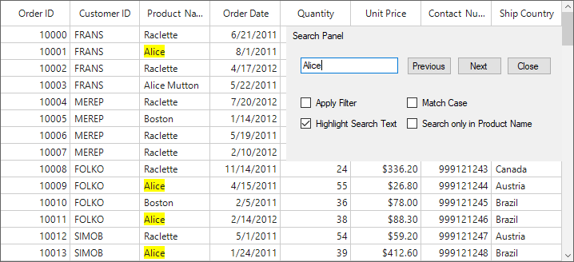

# How to Search the Whole Word in WinForms Data Grid?

This sample demonstrates how to search for the whole word in [WinForms DataGrid](https://www.syncfusion.com/winforms-ui-controls/datagrid) (SfDataGrid) instead of highlighting partial matches.

By default, the Grid uses a contains search condition. This means that if you search for `Ali`, values like `Alice` and `Malice` will also be highlighted. This sample customizes the search behavior so that only cells whose value exactly matches the search text are highlighted.

For example, when searching for `Alice`, the cell with the value `Alice` is highlighted, while `Alice Johnson` and `Malice` are not.

## Features

- Whole-word matching in WinForms Data Grid cells
- Custom `SearchController` implementation
- Supports case-sensitive and case-insensitive matching
- Safely handles special regex meta-characters
- Highlights matching text without partial-match false positives

## Screenshot



## Implementation

This sample overrides the `HighlightSearchText` method in a custom `SearchController` and uses a regular expression with exact matching.

```csharp
public Form1()
{
    InitializeComponent();
    this.sfDataGrid1.SearchController = new CustomSearchController(sfDataGrid1);
}

public class CustomSearchController : SearchController
{
    public CustomSearchController(SfDataGrid dataGrid):base(dataGrid)
    {

    }

    protected override void HighlightSearchText(Graphics paint, DataColumnBase column, CellStyleInfo style,
        Rectangle bounds, string cellValue, RowColumnIndex rowColumnIndex)
    {
        if (AllowHighlightSearchText && !string.IsNullOrEmpty(SearchText))
        {
            if (column != null && (SearchColumns.Count > 0 && !SearchColumns.Contains(column.GridColumn.MappingName)))
                return;

            var searchText = SearchText;
            string[] metaCharacters = { "\\", "^", "$", "{", "}", "[", "]", "(", ")", ".", "*", "+", "?", "|", "<", ">", "-", "&" };
            if (metaCharacters.Any(searchText.Contains))
            {
                for (int i = 0; i < metaCharacters.Length; i++)
                {
                    if (searchText.Contains(metaCharacters[i]))
                        searchText = searchText.Replace(metaCharacters[i], @"\" + metaCharacters[i]);
                }
            }

            searchText = "^(" + searchText + ")$";

            List<int> matchList = Regex.Matches(cellValue, searchText,
                this.AllowCaseSensitiveSearch ? RegexOptions.None : RegexOptions.IgnoreCase)
                .Cast<Match>()
                .Select(s => s.Index).ToList();

            if (matchList.Count > 0 && bounds.Width > 0)
            {
                StringFormat format = new StringFormat(StringFormat.GenericDefault);
                List<CharacterRange[]> characterRangeList = new List<CharacterRange[]>();

                int characterRangeLength = 32;
                int count = matchList.Count / characterRangeLength;
                int range = matchList.Count % characterRangeLength;
                int startIndex = 0;

                if (count > 0)
                {
                    for (int index = 0; index < count; index++)
                    {
                        CharacterRange[] characterRange = new CharacterRange[characterRangeLength];

                        for (int i = 0; i < characterRangeLength; i++)
                        {
                            characterRange[i] = new CharacterRange(matchList[startIndex], SearchText.Length);
                            startIndex++;
                        }

                        characterRangeList.Add(characterRange);
                    }
                }

                if (range > 0)
                {
                    CharacterRange[] characterRange = new CharacterRange[range];
                    for (int i = 0; i < range; i++)
                    {
                        characterRange[i] = new CharacterRange(matchList[startIndex], SearchText.Length);
                        startIndex++;
                    }

                    characterRangeList.Add(characterRange);
                }

                format.LineAlignment = ConvertToStringAlignment(style.VerticalAlignment);
                format.Alignment = ConvertToStringAlignment(style.HorizontalAlignment);

                if (!column.GridColumn.AllowTextWrapping)
                {
                    format.FormatFlags = StringFormatFlags.NoWrap;
                    format.Trimming = column.GridColumn.TextTrimming;
                }

                if (DataGrid.RightToLeft == RightToLeft.Yes)
                    format.FormatFlags = StringFormatFlags.DirectionRightToLeft;

                foreach (var characterRange in characterRangeList)
                {
                    format.SetMeasurableCharacterRanges(characterRange);
                    Region[] regions = paint.MeasureCharacterRanges(cellValue, style.GetFont(), bounds, format);

                    RectangleF[] fillRectangle = new RectangleF[regions.Length];
                    for (int i = 0; i < regions.Length; i++)
                        fillRectangle[i] = regions[i].GetBounds(paint);

                    var highlightColor = SearchColor;
                    if (this.CurrentRowColumnIndex == rowColumnIndex)
                        highlightColor = SearchHighlightColor;

                    using (Brush brush = new SolidBrush(highlightColor))
                        paint.FillRectangles(brush, fillRectangle);
                }
            }
        }
    }

    private StringAlignment ConvertToStringAlignment(VerticalAlignment align)
    {
        switch (align)
        {
            case VerticalAlignment.Bottom: return StringAlignment.Far;
            case VerticalAlignment.Center: return StringAlignment.Center;
            default: return StringAlignment.Near;
        }
    }

    private StringAlignment ConvertToStringAlignment(HorizontalAlignment align)
    {
        switch (align)
        {
            case HorizontalAlignment.Right: return StringAlignment.Far;
            case HorizontalAlignment.Center: return StringAlignment.Center;
            default: return StringAlignment.Near;
        }
    }
}
```

## Requirements to run the demo

- Visual Studio 2015 or later
- Syncfusion WinForms Data Grid package
- .NET Framework support for WinForms applications

## How to run this example

1. Open the project in Visual Studio.
2. Restore the required NuGet packages.
3. Build the project.
4. Run the application.
5. Use the search panel to search for a complete word.

## Resources

- [WinForms DataGrid documentation](https://www.syncfusion.com/winforms-ui-controls/datagrid)
- [Syncfusion WinForms controls](https://www.syncfusion.com/winforms-ui-controls)
- [SyncfusionExamples GitHub](https://github.com/SyncfusionExamples)
